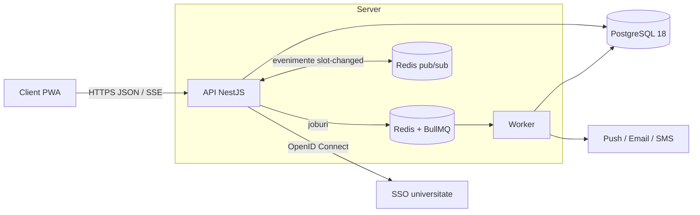

# Structura serverului CampusSport

## 1. Vedere de ansamblu

Serverul este un **monolit modular** (SDD 3.1) scris în TypeScript 6 cu NestJS 12, pe Node.js 24. Din același cod pornesc două procese:

| Proces | Punct de intrare | Rol |
|---|---|---|
| API | `src/main.ts` | REST și SSE sub `/api/v1`, documentație Swagger la `/api/docs`, plus `/health` și `/metrics`. |
| Worker | `src/worker.ts` | Joburile BullMQ: notificări, oferte din lista de așteptare, no-show, partiții lunare. Nu are API HTTP; expune doar metrici pe portul 9101. |



## 2. Directoare

```
backend/
├── src/
│   ├── main.ts, worker.ts          # cele două puncte de intrare
│   ├── app.module.ts               # modulele API-ului
│   ├── worker.module.ts            # modulele worker-ului
│   ├── app.setup.ts                # pipeline-ul HTTP comun: prefix, validare, filtrul de erori
│   ├── swagger.ts                  # documentația OpenAPI generată din cod
│   ├── config/                     # variabilele de mediu, tipizate (infrastructură și secrete)
│   ├── common/                     # cod transversal, fără logică de domeniu
│   │   ├── auth/                   # guard JWT, @Public, @Roles, @CurrentUser, emiterea tokenurilor
│   │   ├── errors/                 # catalogul codurilor de eroare, AppException, filtrul global
│   │   ├── http/                   # validare (422), paginare, limitarea cererilor, pipe pentru {id}
│   │   ├── kv/                     # stocare temporară: Redis sau în memorie (teste)
│   │   ├── db/                     # utilitare SQL: rowsOf, reîncercarea tranzacțiilor
│   │   ├── logging.ts              # loguri JSON (pino)
│   │   └── time.ts                 # zile, luni și ore în fusul orar al bazei sportive
│   ├── database/
│   │   ├── entities/               # câte o entitate TypeORM pentru fiecare tabel
│   │   ├── migrations/             # migrarea inițială aplică SQL-ul din livrabil05
│   │   ├── sql/                    # copia exactă a schema-postgresql.sql
│   │   ├── seeds/                  # datele exemplu din openapi.yaml (seed și teste)
│   │   ├── cli/                    # migrate, seed, enroll-totp, k6-users
│   │   ├── enums.ts                # valorile permise din constrângerile CHECK
│   │   └── tstzrange.ts            # conversia tstzrange <-> { start, end }
│   ├── modules/                    # modulele de domeniu (secțiunea 3)
│   ├── worker/                     # procesoarele BullMQ și sarcinile periodice
│   └── testing/                    # aplicația de test și datele comune pentru teste
├── test/                           # teste end-to-end pe PostgreSQL real
├── k6/                             # teste de încărcare (NFR-01, NFR-02, NFR-04)
├── docker/                         # Keycloak, Prometheus, Grafana, Alloy
├── docker-compose.yml, Dockerfile
└── package.json, tsconfig*.json, eslint.config.mjs, .prettierrc, jest.config.js
```

Testele unitare stau lângă codul testat (`*.spec.ts`), iar testele end-to-end în `test/` (`*.e2e-spec.ts`).

## 3. Modulele de domeniu

Fiecare director din `src/modules/` este un modul NestJS. Primele nouă corespund grupelor de rute (tag-urilor) din `openapi.yaml`; celelalte sunt module tehnice folosite de primele.

| Modul | Tag în API | Rute principale | Cerințe |
|---|---|---|---|
| `auth` | Auth | `/auth/*`, `/me`, `/admin/users` | FR-01, FR-02, FR-05, NFR-08, NFR-11 |
| `catalog` | Catalog | `/sports`, `/resources`, `/admin/sports`, `/admin/resources` | FR-04, FR-06 – FR-08, FR-39 |
| `availability` | Disponibilitate | `/availability`, `/stream/availability` (SSE) | FR-09 – FR-11 |
| `bookings` | Rezervări, Cote | `/bookings`, `/me/bookings`, `/me/quota` | FR-03, FR-12 – FR-18, FR-23 – FR-29 |
| `waitlist` | Listă de așteptare | `/waitlist`, `/me/waitlist` | FR-30 – FR-33 |
| `notifications` | Notificări | `/me/push-subscriptions`, `/me/notification-preferences` | FR-34 – FR-38 |
| `blocks` | Blocări | `/admin/blocks`, `/admin/schedule/*`, `/admin/events` | FR-19 – FR-22, FR-40 – FR-42 |
| `admin` | Administrare și rapoarte | `/admin/settings`, `/admin/audit-log`, `/admin/dashboard`, `/admin/reports` | FR-43 – FR-46 |
| `health`, `metrics` | (excluse din Swagger) | `/health`, `/metrics` | SYS-09 |

Module tehnice, fără rute proprii:

| Modul | Rol |
|---|---|
| `settings` | Citește regulile din tabelul `settings` la fiecare cerere (SDD 2.1). |
| `quota` | Contorul lunar per student și numărul de rezervări active. |
| `audit` | Scrie în jurnalul de audit, în aceeași tranzacție cu modificarea. |
| `events` | Ce se întâmplă după commit: anunță grila prin SSE și pune joburi în coadă. |
| `jobs` | Producătorul de joburi BullMQ (cozile `notifications`, `waitlist`, `bookings`). |
| `realtime` | Distribuirea evenimentelor `slot-changed` între instanțe, prin Redis pub/sub. |
| `messaging` | Trimiterea emailurilor (SMTP) și a SMS-urilor (deocamdată doar în log). |

### Structura internă a unui modul

Toate modulele urmează același model; `bookings` este exemplul cel mai complet:

```
modules/bookings/
├── bookings.module.ts        # declară controller-ele și serviciile
├── bookings.controller.ts    # rutele HTTP: validare, rol, cod de răspuns; fără logică
├── bookings.service.ts       # logica și tranzacțiile
├── booking-rules.ts          # reguli pure (fără bază de date), folosite și de grila de disponibilitate
├── booking.presenter.ts      # conversia rând din baza de date -> răspuns JSON
├── qr.service.ts             # semnarea și verificarea codului QR
├── dto/booking.dto.ts        # forma cererilor și răspunsurilor, cu validare și documentație Swagger
└── *.spec.ts                 # testele
```

## 4. Drumul unei cereri

Exemplu: `POST /api/v1/bookings`.

1. **Guard-ul JWT** (`common/auth/jwt-auth.guard.ts`) verifică tokenul și reîncarcă utilizatorul din baza de date, ca o suspendare să aibă efect imediat. Fără token răspunde `401`, iar cu rolul greșit `403`.
2. **Limitarea cererilor** permite 10 rezervări pe minut per utilizator; la depășire răspunde `429` cu `Retry-After`.
3. **Validarea** (`class-validator`) verifică DTO-ul; datele greșite produc `422 VALIDATION_FAILED`, cu câmpurile în `details`.
4. **Controller-ul** apelează `BookingsService.create`.
5. **Serviciul** rulează algoritmul din SDD 7.1 într-o singură tranzacție:
   - blochează rândul utilizatorului, ca două cereri ale aceleiași persoane să nu treacă simultan de verificarea cotei;
   - citește regulile din `settings`;
   - aplică regulile din `booking-rules.ts` (cont activ, fereastră după rol, acces extern, cotă, limita de rezervări active);
   - inserează rândul în `occupancy`; constrângerea `no_overlap` decide care dintre cererile simultane câștigă.
6. **După commit**, `OccupancyEventsService` anunță grila prin SSE și pune în coadă confirmarea, reminderele și verificarea no-show.
7. **Filtrul global de erori** transformă orice excepție în `{ code, message_ro, message_en, details? }`. De exemplu, încălcarea `no_overlap` (cod PostgreSQL `23P01`) devine `409 SLOT_TAKEN`.

## 5. Worker-ul

`src/worker/processors.ts` conține câte un procesor pentru fiecare coadă:

| Coadă | Joburi | Ce fac |
|---|---|---|
| `notifications` | `booking-confirmed`, `booking-reminder`, `booking-cancelled`, `waitlist-offer` | Trimit pe push, email sau SMS după preferințe; anunțurile critice ignoră preferințele și trec pe SMS dacă push-ul nu a ajuns (FR-36). Fiecare încercare se salvează în `notifications`. |
| `waitlist` | `slot-freed`, `offer-expired`, `offer-scan` | Oferă slotul eliberat primului din listă pentru 10 minute, sau tuturor deodată dacă slotul începe în mai puțin de 2 h (SDD 7.2). |
| `bookings` | `no-show-check`, `maintenance`, `partitions` | Marchează no-show-urile și suspendă contul după 3 într-o lună; finalizează rezervările cu check-in; creează partițiile lunare. |

Joburile periodice sunt înregistrate la pornirea worker-ului (`SchedulerService`) și acoperă joburile pierdute dacă Redis a fost oprit.

## 6. Datele

- **Schema** vine exclusiv din `livrabil05/baza-de-date/schema-postgresql.sql`. Migrarea o aplică neschimbată, TypeORM rulează cu `synchronize: false`, iar un test verifică faptul că, în `backend/src/database/sql/`, copia este identică.
- **Entitățile** (`database/entities/`) au proprietăți în camelCase și coloane în snake_case, de exemplu `fullName` ↔ `full_name`.
- **`occupancy`** este tabelul central: rezervările și toate tipurile de blocări stau împreună, sub aceeași constrângere `no_overlap`. Coloana `period` (`tstzrange`) apare în API ca `start` / `end`.
- **Starea temporară** (coduri OTP, sesiuni de reîmprospătare, starea SSO, provocările 2FA) stă în Redis, cu durată de viață, nu în tabele.
- **Datele exemplu** (`database/seeds/example-data.ts`) folosesc identificatorii și valorile din `openapi.yaml` (ex. „Teren baschet 2”, „Ion Popescu”). Seed-ul și testele folosesc aceleași date.

## 7. Configurarea

| Ce | Unde | Exemple |
|---|---|---|
| Infrastructură și secrete | variabile de mediu (`.env` local), citite în `config/configuration.ts` | conexiunea la baza de date, Redis, secretul JWT, furnizorul SSO, SMTP, cheile VAPID |
| Reguli de business | tabelul `settings`, modificabil prin `PUT /admin/settings` | cota lunară, ferestrele de rezervare, anularea gratuită, check-in, no-show, lista de așteptare |

Regulile nu se scriu niciodată în cod: se citesc la fiecare cerere, deci o modificare făcută de administrator se aplică imediat, fără redeploy.

## 8. Testele

| Nivel | Unde | Ce verifică |
|---|---|---|
| Unitare | `src/**/*.spec.ts` | Regulile, sloturile, algoritmii, mesajele. |
| Controller | `src/modules/**/*.controller.spec.ts` | Pentru fiecare rută: codul de răspuns, rolul, validarea și forma răspunsului, cu datele exemplu din specificație. |
| Conformitate | `src/spec-conformance.spec.ts` | Toate cele 60 de operații: aceeași metodă, cale și același rol ca în `openapi.json`. |
| End-to-end | `test/app.e2e-spec.ts` | Întreaga aplicație pe PostgreSQL 18 real, inclusiv cele 50 de rezervări simultane. |
| Încărcare | `k6/` | 100 de rezervări simultane (NFR-04); timpul de răspuns al grilei sub sarcină (NFR-01, NFR-02). |

## 9. Ce mai rămâne de implementat

Rutele care răspund cu `501 NOT_IMPLEMENTED` sunt:

- exportul datelor personale;
- fișierele și abonamentul iCal;
- invitațiile pentru echipă;
- gestionarea rezervărilor de către administrator;
- importul orarului EF;
- evenimentele universității;
- anunțurile;
- panoul zilnic și rapoartele;
- blocările recurente.

Lista exactă este în `backend/README.md`. Fiecare rută există deja cu ruta, rolul și documentația Swagger corecte, deci implementarea nu schimbă contractul API.
